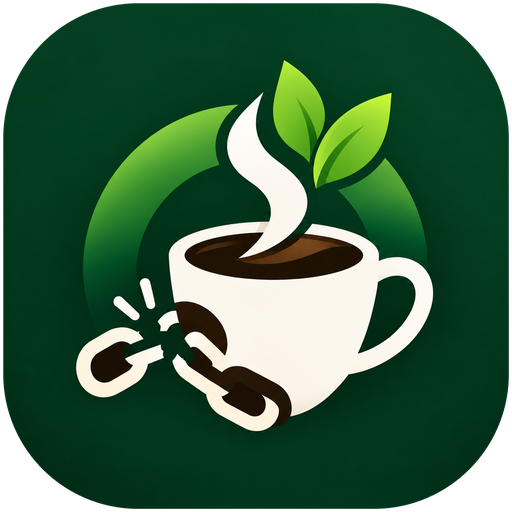
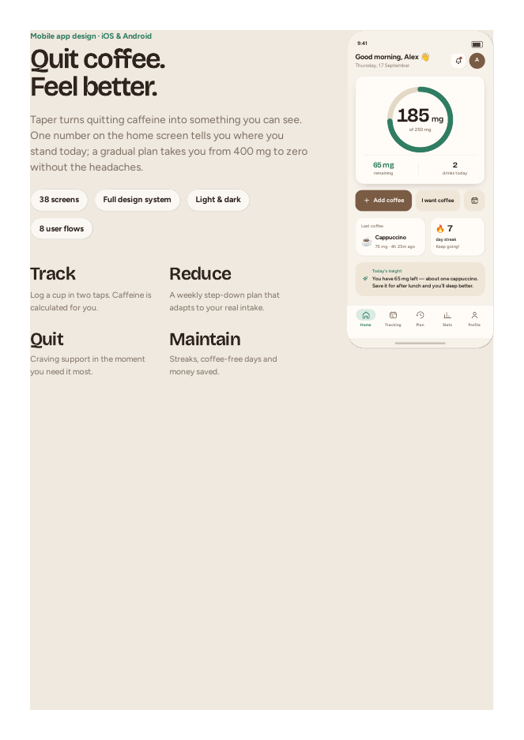
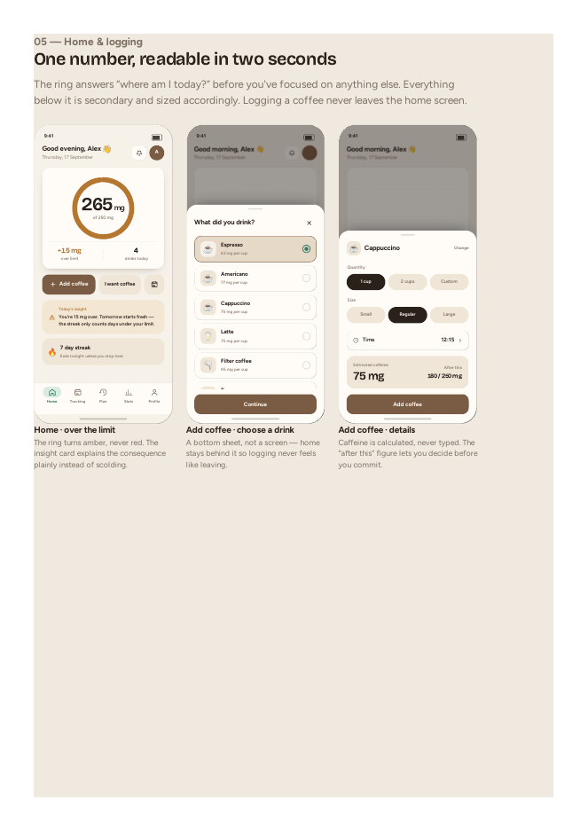
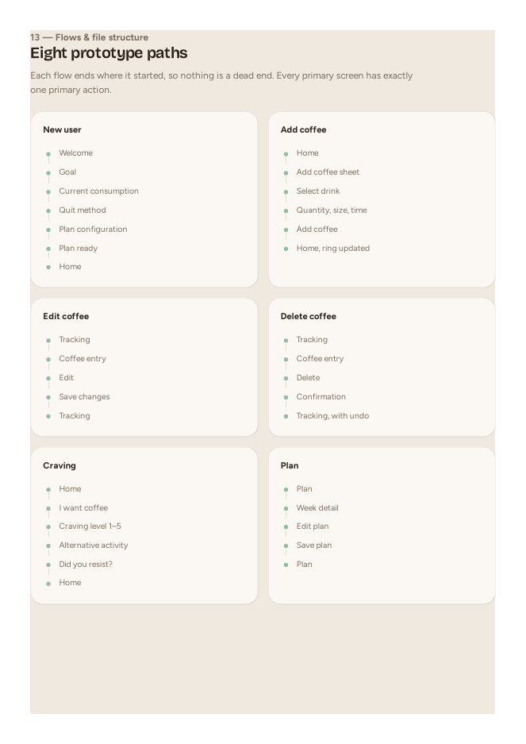

<p align="center">
  
</p>

<h1 align="center">NoCoffee</h1>

<p align="center">Quit or reduce coffee and caffeine, one step at a time.</p>

A mobile app (Android and iOS, built with Flutter) that helps you cut down on caffeine with a plan that steps down week by week. No accounts, no servers: everything stays on your device.

I built this on my own as a portfolio project, from the design to the code. It is not published on any app store.

## Design

I designed the screens first (about 38 of them, light and dark) and then built the app from that spec. A few pages from the design:

<p>
  
  
  
</p>

The design was drafted under the working name "Taper". The app itself is called NoCoffee.

## Features

- **Personal plan.** Choose to reduce or quit, gradually or immediately, pick a start date and a speed (gentle, steady, fast). The weekly limits are worked out from how much you drink now.
- **Tracking.** Log drinks, edit or delete them, and look back at any day.
- **History and statistics.** Day, week and month views, a calendar, averages, change versus your usual intake, streaks and money saved.
- **Cravings.** A short flow for getting through a craving, with a log of the ones you resisted.
- **Achievements.** Milestones for streaks, weeks completed and savings.
- **Notifications.** Daily motivation, coffee reminders, daily progress, streak reminders and quiet hours. A limit warning appears inside the app.
- **Light and dark themes.**

## Privacy

All data (drinks, plan, profile, cravings, settings) is stored locally with `shared_preferences`. Nothing is uploaded and there is no analytics. "Delete all data" in Settings erases everything.

## Tech

- Flutter / Dart, Material 3
- State: `ChangeNotifier` with an `InheritedWidget`
- Storage: `shared_preferences`
- Notifications: `flutter_local_notifications`, `timezone`, `flutter_timezone`

## Getting started

```
flutter pub get
dart run flutter_launcher_icons
flutter run -d chrome
```

Notifications only work on a phone, not in the browser.

### Build an Android APK

```
flutter build apk --release
```

The file is created at `build/app/outputs/flutter-apk/app-release.apk`.

## Note

Just a hobby and portfolio project. It tracks caffeine, but it is not medical advice, so check with a doctor before making big changes to your intake.
